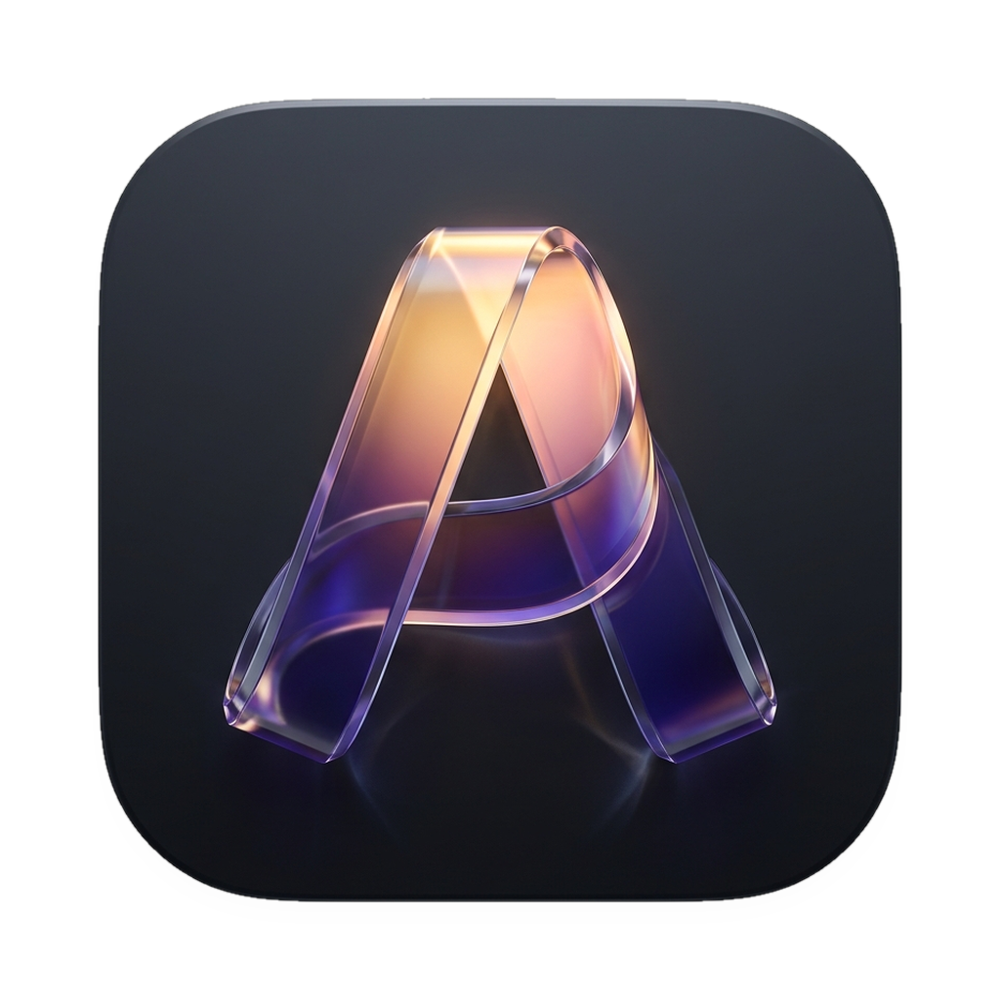

<div align="center">



# Aubade

### from an audiophile to an audiophile. a local first music player.

<p align="center">
  <a href="https://github.com/workbydivyanshu/aubade-music-player/releases/latest">
    
  </a>
  <a href="#">
    
  </a>
  <a href="#">
    
  </a>
  <a href="#">
    
  </a>
  <a href="LICENSE">
    
  </a>
</p>

</div>

---

## The Philosophy

Modern music streaming traded away what mattered most: **sound quality, genuine ownership, and privacy**. Music got compressed into lossy 256kbps streams, trapped inside bloated web views, and tracked by algorithmic surveillance.

**Aubade is the antithesis.**

Built for those who curate their own FLAC, ALAC, WAV, and DSD collections, Aubade combines **bit-perfect audiophile playback** with an **Apple-caliber liquid glass interface**. No telemetry, no forced subscriptions, no compromises. Your music stays on your disk, rendered through direct hardware audio pipelines, wrapped in an interface that honors the art.

---

## Key Highlights

### 💎 Liquid Glass & Ambient Artwork Aura
- **Optical Glass Aesthetics**: Frosted acrylic backdrop blur, continuous squircle curvature, and chamfered optical rims that react to ambient light.
- **The App Wears the Record**: Intelligent color-engine extracts the harmonic palette of the playing album cover and radiates a dynamic ambient aura across the window, paired with real-time luminance clamping so typography remains razor-sharp.

### 🔊 Bit-Perfect Lossless Sound Pipeline
- **Hardware-Direct Audio Engine**: Powered by `mpv` with low-latency hardware backends: **PipeWire / ALSA** on Linux, **WASAPI Exclusive** on Windows, and **CoreAudio** on macOS.
- **Live Stream Telemetry HUD**: Real-time format inspector displaying sample rate (up to 192kHz/384kHz+), bit depth (16/24/32-bit float), live bitrate, and container codec tags.
- **Pure Local Formats**: Native hardware decoding for FLAC, ALAC, WAV, DSD, AIFF, Ogg Vorbis, Opus, and MP3.

### 🏝️ Floating Island Player Dock
- **Minimal Desktop Footprint**: An isolated, floating island dock positioned 12px above the viewport with continuous r16 corners, tactile timeline scrubbers, kinetic volume physics, and instantaneous quick-controls.

### ⚡ Tauon-Grade Library Scanner
- **Ultra-Fast Multi-Threaded Indexing**: Scans tens of thousands of lossless audio files in seconds using filesystem `mtime` change detection.
- **Zero Cold-Boot Overhead**: Unchanged directories skip re-reading entirely. Launch Aubade and your library is ready in milliseconds.
- **Artwork Auto-Discovery**: Automatically matches embedded ID3/Vorbis/FLAC artwork or folder companion covers (`cover.jpg`, `folder.png`, `front.jpg`).

### 🎤 Synced Karaoke Lyrics & .lrc Sidecars
- **Kinetic Lyric Typography**: Word-by-word and line-by-line real-time karaoke lyrics display with smooth kinetic scrolling.
- **Local Sidecar Persistence**: Synced lyrics are automatically persisted as `.lrc` sidecar files right next to your audio tracks (`track.flac` → `track.lrc`), keeping your synchronized lyrics offline with your collection forever.

### 📊 The Listening Vault (100% Offline Bento Analytics)
- **Zero-Telemetry Insights**: A private, on-device Bento analytics dashboard powered by SQLite.
- **Deep Listening Telemetry**: Track total listening hours, active listening day-streaks, top albums and artists, lossless vs. lossy format distribution, and hourly listening heatmaps.
- **100% Private**: Zero analytics pings. Nothing ever leaves your machine.

### 🎧 Resilient Offline Last.fm Scrobbler
- **Offline Scrobble Queue**: Listen on a flight or without internet—every track is queued locally in an ACID SQLite transaction log.
- **Automatic Sync**: The moment network connectivity returns, scrobbles drain automatically with jitter backoff.

### 🎮 Discord Rich Presence Daemon
- **Handcrafted IPC Daemon**: Communicates directly through raw Unix domain sockets and Windows named pipes.
- **Zero Web Bloat**: Displays your currently playing track, artist, album, elapsed playback time, and Hi-Res audio badge on your Discord profile without heavy Discord RPC libraries.

### 🔄 Seamless In-App Updates
- **Built-in Release Channel**: Automatically checks GitHub releases for updates, presents release notes in a frosted glass modal, and downloads/launches native OS packages with one click.

---

## Downloads & Installation

Pre-built binaries for all major desktop operating systems are available on the [Releases](https://github.com/workbydivyanshu/aubade-music-player/releases) page.

| Platform | Format | How to Install |
| :--- | :--- | :--- |
| **Fedora / RHEL / openSUSE** | `.rpm` | `sudo dnf install ./aubade-1.0.0-1.fc44.x86_64.rpm` |
| **Ubuntu / Debian / Linux Mint** | `.deb` | `sudo apt install ./aubade_1.0.0_amd64.deb` |
| **Universal Linux (Any Distro)** | `.AppImage` | `chmod +x aubade_1.0.0_x86_64.AppImage && ./aubade_1.0.0_x86_64.AppImage` |
| **macOS (Apple Silicon)** | `.dmg` | Mount `aubade_1.0.0_macos.dmg` and drag to `Applications` |
| **Windows 10 / 11** | `.exe` / `.zip` | Run `aubade_1.0.0_windows-x86_64-setup.exe` or extract portable `.zip` |

---

## Engineering & Architecture

Aubade is engineered from the ground up for desktop performance, memory efficiency, and rock-solid audio stability:

```
┌────────────────────────────────────────────────────────┐
│               Aubade Liquid Glass UI                   │
│   (Frosted Acrylic · Ambient Aura · Floating Island)   │
├───────────────────────────┬────────────────────────────┤
│      Listening Vault      │     Local Scanner Engine   │
│   (Offline SQLite Bento)  │   (Tauon mtime Caching)    │
├───────────────────────────┴────────────────────────────┤
│                 Audio Pipeline Core                    │
│   (libmpv Direct · Stream Telemetry · Bit-Perfect)     │
├───────────────────┬──────────────────┬─────────────────┤
│ Linux (PipeWire)  │ Windows (WASAPI) │ macOS (CoreAud) │
└───────────────────┴──────────────────┴─────────────────┘
```

- **Framework**: Flutter Desktop with custom C++/Obj-C/Win32 runner hooks
- **Playback Core**: `media_kit` + `libmpv` (hardware acceleration, low-latency buffer management)
- **Local Database**: SQLite FFI with WAL mode for zero-lag concurrent reads
- **IPC Presence**: Raw asynchronous socket stream client (no third-party node/electron wrappers)

---

## Building from Source

### Prerequisites
- [Flutter SDK](https://flutter.dev) (version `3.13.3` or newer)
- Platform toolchain:
  - **Linux**: `mpv-libs`, `gtk3-devel`, `keybinder3-devel`, `libarchive`
  - **macOS**: Xcode 15+, CocoaPods
  - **Windows**: Visual Studio 2022 (C++ Desktop Development), Inno Setup (optional for installer)

### Quick Build
```bash
# Clone the repository
git clone https://github.com/workbydivyanshu/aubade-music-player.git
cd aubade-music-player

# Fetch dependencies
flutter pub get

# Run in development
flutter run -d linux   # or macos, windows

# Build optimized release package
flutter build linux --release
```

---

## License

Aubade is proudly open-source software licensed under the **[MIT License](LICENSE)**.